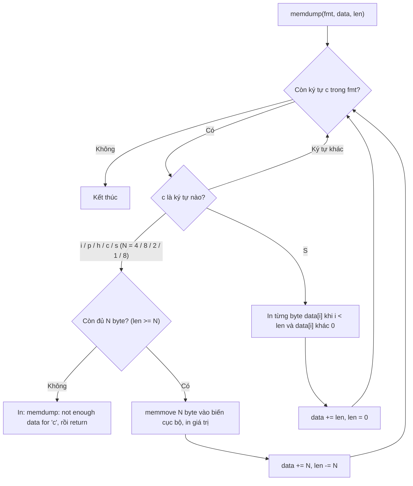
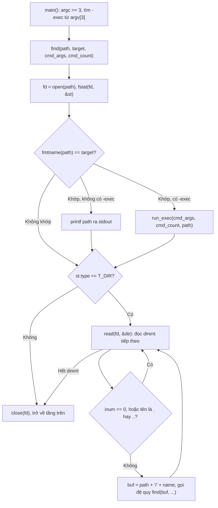
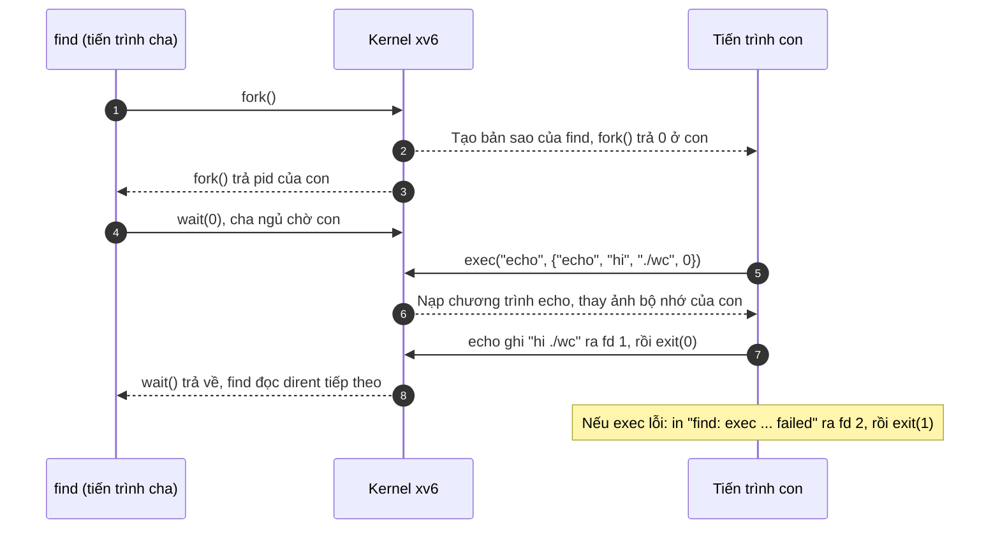

# BÁO CÁO ĐỒ ÁN 1: XV6 UTILITIES & SYSTEM CALLS
## PHẦN BÁO CÁO CỦA THÀNH VIÊN 1

---

## THÔNG TIN CHUNG

| Mục | Thông tin chi tiết |
| :--- | :--- |
| **Môn học** | Hệ điều hành |
| **Lớp học phần** | 24_21 |
| **Nhóm thực hiện** | 12 |
| **Hệ thống thử nghiệm** | Ubuntu 22.04.5 LTS trên VMware – Kiến trúc RISC-V (`qemu-system-riscv64` 6.2.0, `riscv64-linux-gnu-gcc` 11.4.0) |
| **Cấu trúc nộp bài** | `MSSV1_MSSV2_MSSV3.zip` chứa `Report.pdf` và thư mục `Release/` |

### Thông tin thành viên phụ trách
- **STT:** 1
- **MSSV:** `24120397`
- **Họ và tên:** `Trương Bảo Nguyên`
- **Nhánh Git:** `util`
- **Nhiệm vụ chính phụ trách:** Bài 1 (memdump) & Bài 2 (find + exec)
- **Tỉ lệ đóng góp:** 100% (bài 1 và bài 2)

---

## BÀI 1. MEMDUMP (1.5 điểm)
*(Thuộc Phần 1: Lab Utilities - Nhánh `util`)*

- **Người thực hiện:** `Trương Bảo Nguyên` – `24120397` (Đóng góp: 100%)

#### Hướng giải quyết (Ý tưởng chính):
- Duyệt lần lượt từng ký tự của `fmt`. Dùng chính tham số `data` làm con trỏ đọc và `len` làm **số byte còn lại**: mỗi lần đọc N byte thì `data += N`, `len -= N`. Nhờ vậy điều kiện kiểm tra biên chỉ là `len < N`.
- Kiểm tra biên **trước** khi đọc. Thiếu byte thì in `memdump: not enough data for 'X'` rồi `return` ngay, không đọc thêm byte nào.
- Đọc giá trị bằng `memmove` vào biến cục bộ đúng kích thước thay vì ép kiểu `*(int *)data`. `data` có thể nằm ở địa chỉ không chia hết cho 4 hoặc 8 (ví dụ format `ci`), còn `memmove` chép từng byte nên không phụ thuộc căn lề (alignment).
- Format `S` không dùng `%s`, vì phần dữ liệu còn lại có thể không có `\0` và `%s` sẽ đọc vượt `len`. Thay vào đó, in từng ký tự với điều kiện `i < len` và dừng khi gặp `\0`.

| Ký tự | Số byte | Đọc vào | In bằng |
| :---: | :---: | :--- | :--- |
| `i` | 4 | `int` | `%d` |
| `p` | 8 | `uint64` | `%lx`: hexa, không có tiền tố `0x`, giống output mẫu `6564306364616564` |
| `h` | 2 | `short` | `%d`, giữ dấu |
| `c` | 1 | `*data` | `%c` |
| `s` | 8 | `char *` (con trỏ 64-bit) | `%s`: chuỗi nằm ngoài `data`, `len` chỉ giới hạn 8 byte con trỏ |
| `S` | phần còn lại | – | Từng ký tự, đến `\0` hoặc hết `len` |

- Ký tự format không có trong bảng: đề không quy định, nhóm chọn **bỏ qua và không tiêu thụ byte nào** (ví dụ `echo hi | memdump xc` in ra `h`).

#### Thay đổi mấu chốt:
- **File chỉnh sửa:** `user/memdump.c`
  - Hiện thực thân hàm `memdump()`. Hàm được định nghĩa trước `main()` nên bỏ dòng khai báo nguyên mẫu ở đầu file.
  - `main()` (MIT viết sẵn) giữ nguyên. `Makefile` của lab đã có sẵn `$U/_memdump` nên không cần sửa.
- Mỗi `case` theo cùng một khuôn và có cặp `{ }` riêng, để biến `val` được khai báo với kiểu khác nhau ở từng case (`int`, `uint64`, `short`) mà không trùng tên. Ví dụ `i` và `S`:

```c
case 'i': {
  if (len < 4) {                     // kiểm tra biên TRƯỚC khi đọc
    printf("memdump: not enough data for '%c'\n", c);
    return;
  }
  int val;
  memmove(&val, data, 4);            // an toàn với địa chỉ không căn lề
  printf("%d\n", val);
  data += 4;
  len -= 4;                          // len luôn là số byte còn lại
  break;
}

case 'S': {
  for (int i = 0; i < len; i++) {    // không bao giờ đọc quá len
    if (data[i] == '\0') {
      break;
    }
    printf("%c", data[i]);
  }
  printf("\n");
  data += len;                       // S dùng hết phần còn lại
  len = 0;
  break;
}
```

#### Luồng hoạt động:



#### Kiểm thử & Hạn chế:
- **Kiểm thử tự động:** `./grade-lab-util memdump`, cả 3 test OK (25/25 điểm grader):

```
== Test memdump, examples == memdump, examples: OK (2.0s)
== Test memdump, format ii, S, p == memdump, format ii, S, p: OK (0.6s)
== Test memdump, formats h c, bounds checking, usage == memdump, formats h c, bounds checking, usage: OK (1.0s)
```

- **Kiểm thử thủ công trong xv6:** các lệnh mẫu của đề cho ra đúng output mẫu.

```
$ echo deadc0de | memdump hhcccc
25956
25697
c
0
d
e
$ echo deadc0de | memdump p
6564306364616564
$ echo a | memdump i
memdump: not enough data for 'i'
$ echo abc | memdump ii
174285409
memdump: not enough data for 'i'
```

  - `memdump` không tham số in đủ 5 example giống đề. Dòng đầu Example 4 ra `C58` thay vì `BD0` vì đó là địa chỉ của chuỗi `"hello"`, phụ thuộc kích thước code (đề đã lưu ý điểm này).
  - `echo abc | memdump ii`: `i` thứ nhất đọc 4 byte `61 62 63 0A`, theo little-endian ghép thành `0x0A636261` = 174285409. `i` thứ hai không còn byte nào nên báo lỗi và dừng.
- **Vấn đề gặp phải:**
  - Bản đầu tiên không build được: một biến khai báo nhưng không dùng (`int size;`) bị cờ `-Wall -Werror` của `Makefile` biến thành lỗi. Đã xóa biến này.
  - Thiếu `\n` sau mỗi giá trị, trong khi grader so khớp theo từng dòng (`^61810`, `^2026`). Đã thêm `\n` cho mọi format; với `S` thì in `\n` sau vòng lặp.
  - Ban đầu in `p` bằng `%p`, nhưng `%p` của xv6 luôn in tiền tố `0x` và đủ 16 chữ số. Đã đổi sang `%lx`; không dùng `%x` vì `%x` chỉ in 32 bit thấp.
- **Hạn chế:**
  - Format `s` coi 8 byte là một con trỏ hợp lệ. Nếu không phải (ví dụ `echo abcdefgh | memdump s`), process bị kernel kết thúc với `usertrap(): unexpected scause 0xd` (load page fault), shell vẫn chạy bình thường. Chương trình user không có cách kiểm tra một địa chỉ có hợp lệ hay không, và đề cũng không yêu cầu.
  - Với `echo ... | memdump S`, ký tự `\n` do `echo` thêm vào cũng là dữ liệu nên được in ra; cộng với `\n` kết thúc của `S`, output có thêm một dòng trống. Grader không bị ảnh hưởng.

---

## BÀI 2. FIND + EXEC (2.5 điểm)
*(Thuộc Phần 1: Lab Utilities - Nhánh `util`)*

- **Người thực hiện:** `[MSSV]` – `[Họ và tên]` (Đóng góp: 100%, cả Part A và Part B)

#### Hướng giải quyết (Ý tưởng chính):
- **Part A – find:** Dựa trên cách `user/ls.c` đọc thư mục. Hàm đệ quy `find(path, ...)` mở `path`, lấy loại bằng `fstat`, rồi so **tên cuối** của đường dẫn (`fmtname(path)`) với `target` cho mọi loại, cả file lẫn thư mục; khớp thì in `path`. Nếu `path` là thư mục thì đọc lần lượt từng `struct dirent`, ghép `path/tên` vào buffer và gọi đệ quy. Bỏ qua `.` và `..` để không lặp vô hạn và không in trùng.
- **Part B – -exec:** `main()` tìm chữ `-exec` từ `argv[3]`; các từ phía sau là lệnh và tham số của nó. Với mỗi đường dẫn khớp, `run_exec()` dựng mảng tham số mới `{cmd, args..., path, 0}`, gọi `fork()` để tiến trình con `exec` lệnh đó, còn tiến trình cha `wait()` cho con chạy xong rồi mới tìm tiếp. Phải `fork` vì `exec` thay toàn bộ ảnh bộ nhớ của tiến trình gọi nó; nếu `find` tự `exec` thì sẽ mất sau file khớp đầu tiên.
- Kết quả (đường dẫn) in ra stdout bằng `printf`. Mọi thông báo lỗi in ra stderr bằng `fprintf(2, ...)`, giống `ls`, `cat`, `grep` của xv6, để khi chuyển hướng (`find . b > list.txt`) lỗi không lẫn vào kết quả.

#### Thay đổi mấu chốt:

| File / hàm | Thay đổi | Lý do |
| :--- | :--- | :--- |
| `user/find.c` (file mới) – `fmtname()` | Duyệt lùi đến dấu `/` cuối cùng, trả về con trỏ tới phần tên | Khác `fmtname` của `ls.c`: không đệm khoảng trắng, để so sánh chính xác bằng `strcmp` |
| `find()` | Đệ quy duyệt cây; bỏ `dirent` có `inum == 0`, bỏ `.` và `..`; kiểm tra độ dài trước khi ghép vào `buf[512]`; `close(fd)` trước khi trả về | Yêu cầu Part A; tránh tràn buffer; mỗi process xv6 chỉ có 16 fd (`NOFILE`) |
| `run_exec()` | Dựng `exec_argv[MAXARG]`, rồi `fork` / `exec` / `wait` | Yêu cầu Part B; `MAXARG` (`kernel/param.h`) là số tham số tối đa của `exec` |
| `main()` | Kiểm tra `argc >= 3`; tách phần sau `-exec` bằng cách trỏ vào giữa `argv` (không chép chuỗi) | Báo `Usage` hoặc `find: -exec requires a command` khi nhập sai |
| `Makefile` | Thêm `$U/_find` vào `UPROGS` trong khối `ifeq ($(LAB),util)` | Để `find` được biên dịch và đưa vào `fs.img` |
| `time.txt` (file mới) | Số giờ làm lab | Grader có test `time` |

- Tên trong `struct dirent` dài tối đa `DIRSIZ = 14` byte và **không có `\0`** khi tên dài đúng 14 ký tự, nên phải chép ra mảng `DIRSIZ + 1` trước khi dùng các hàm chuỗi:

```c
char name[DIRSIZ + 1];
int i;
for (i = 0; i < DIRSIZ && de.name[i] != 0; i++) {
  name[i] = de.name[i];
}
name[i] = 0;

if (strcmp(name, ".") == 0 || strcmp(name, "..") == 0)
  continue;

memmove(p, name, strlen(name) + 1);      // buf = path + "/" + name
find(buf, target, cmd_args, cmd_count);
```

- Phần lõi của `run_exec()`:

```c
exec_argv[cmd_count] = path;             // đường dẫn tìm được là tham số cuối
exec_argv[cmd_count + 1] = 0;            // exec cần mảng argv kết thúc bằng 0

int pid = fork();
// (pid < 0: in "find: fork failed" và bỏ qua file này)
if (pid == 0) {
  exec(exec_argv[0], exec_argv);
  fprintf(2, "find: exec %s failed\n", exec_argv[0]);   // chỉ chạy khi exec lỗi
  exit(1);                               // không để tiến trình con chạy tiếp find
} else {
  wait(0);                               // chạy lần lượt từng file, không để lại zombie
}
```

#### Luồng hoạt động:

Duyệt cây thư mục (Part A) và rẽ nhánh `-exec` (Part B):



Một lần chạy lệnh qua `-exec`, ví dụ `find . wc -exec echo hi` (user program → syscall → kernel → trả kết quả):



#### Kiểm thử & Hạn chế:
- **Kiểm thử tự động:** `./grade-lab-util find exec time`, cả 8 test OK (40 + 30 + 1 điểm grader):

```
== Test find, in current directory == find, in current directory: OK (0.9s)
== Test find, in sub-directory == find, in sub-directory: OK (0.8s)
== Test find, recursive == find, recursive: OK (1.0s)
== Test exec == exec: OK (0.9s)
== Test exec, multiple args == exec, multiple args: OK (1.1s)
== Test exec via sh script == exec via sh script: OK (1.2s)
== Test find, missing target, no duplicates, directory match == find, missing target, no duplicates, directory match: OK (1.2s)
== Test time ==
time: OK
```

- **Kiểm thử thủ công trong xv6** (đã tạo `b`, `a/b`, `a/aa/b` như đề):

| Lệnh | Kết quả | Ý nghĩa |
| :--- | :--- | :--- |
| `find . b` | `./b`, `./a/b`, `./a/aa/b` | Đúng ví dụ của đề |
| `find a/aa b` | `a/aa/b` | Chỉ tìm trong thư mục `path` đã cho |
| `find . nosuch` | Không in gì | Không tìm thấy thì im lặng, không crash |
| `mkdir x`, `mkdir x/x`, `find . x` | `./x`, `./x/x` | Thư mục trùng tên được in, rồi vẫn tìm tiếp bên trong |
| `echo > abcdefghijklmn`, `find . abcdefghijklmn` | `./abcdefghijklmn` | Tên dài đúng 14 ký tự (không có `\0` trong `dirent`) |
| `find . wc -exec echo hi` | `hi ./wc` | Đúng ví dụ của đề |
| `find . b -exec echo x y z` | `x y z ./b`, `x y z ./a/b`, `x y z ./a/aa/b` | Nhiều tham số giữ đúng thứ tự, đường dẫn nối vào cuối |
| `find` | `Usage: find <path> <target> [-exec cmd ...]` | Thiếu tham số |
| `find . b -exec` | `find: -exec requires a command` | Có `-exec` nhưng thiếu lệnh |
| `find . wc -exec nosuchcmd` | `find: exec nosuchcmd failed` (đúng 1 lần) | Chỉ tiến trình con báo lỗi rồi thoát |
| `find nosuch b > err.txt`, `cat err.txt` | Lỗi hiện trên màn hình, `err.txt` rỗng | Lỗi đi ra stderr, không lẫn vào kết quả |

  - `sh < findtest.sh` (trên file system mới) in đúng 3 dòng `hello` như đề.
- **Vấn đề gặp phải:** `make qemu` dùng lại `fs.img` nếu file đã tồn tại, và grader của lab không tự tạo lại file system sạch. Sau khi thử tay, các file còn sót trong `fs.img` làm test find báo FAIL dù code đúng. Cách xử lý: chạy `rm -f fs.img` trước khi chấm.
- **Hạn chế:**
  - **Cây thư mục lồng quá sâu:** mỗi tầng đệ quy của `find` chiếm 672 byte stack (chủ yếu là buffer đường dẫn 512 byte), trong khi stack user của lab util chỉ có 2 trang = 8192 byte (`USERSTACK 2` trong `kernel/param.h`). Đo thực tế: lồng 11 tầng chạy bình thường, đến tầng 12 thì `find` bị kernel kết thúc với `usertrap(): unexpected scause 0xf` (ghi vào trang bảo vệ dưới stack). Shell vẫn chạy tiếp. Grader chỉ lồng tối đa 3 tầng nên không ảnh hưởng. Hướng khắc phục: giảm dữ liệu đặt trên stack ở mỗi tầng, ví dụ dùng chung một buffer đường dẫn cho mọi tầng thay vì mỗi tầng một buffer 512 byte.
  - `find / b` in ra `//b`, `//a/b`, ... vì chương trình luôn ghép `path` + `/` + tên. xv6 vẫn hiểu `//b` là `/b` nên kết quả dùng được, chỉ khác cách in của `find` trên Linux.
  - Chỉ hỗ trợ một tùy chọn `-exec`. Các từ thừa đứng giữa `target` và `-exec` bị bỏ qua mà không báo lỗi (`find . b foo` chạy như `find . b`).

---

## QUY TRÌNH BUILD & KIỂM THỬ (BÀI 1, BÀI 2)

```bash
# 1. Chuyển sang nhánh làm việc util
git checkout util

# 2. Biên dịch và chạy test của Bài 1, Bài 2
make clean
rm -f fs.img          # xóa file system cũ để test find không bị ảnh hưởng
./grade-lab-util memdump find exec time

# 3. Kiểm thử thủ công
make qemu
# Trong QEMU:
# - Bài 1: memdump; echo deadc0de | memdump hhcccc; echo deadc0de | memdump p; echo a | memdump i
# - Bài 2: echo > b; mkdir a; echo > a/b; mkdir a/aa; echo > a/aa/b; find . b; find . wc -exec echo hi
# - Bài 2 (bật lại QEMU để có file system mới): sh < findtest.sh
# Thoát QEMU: Nhấn Ctrl+A rồi nhấn X
```
