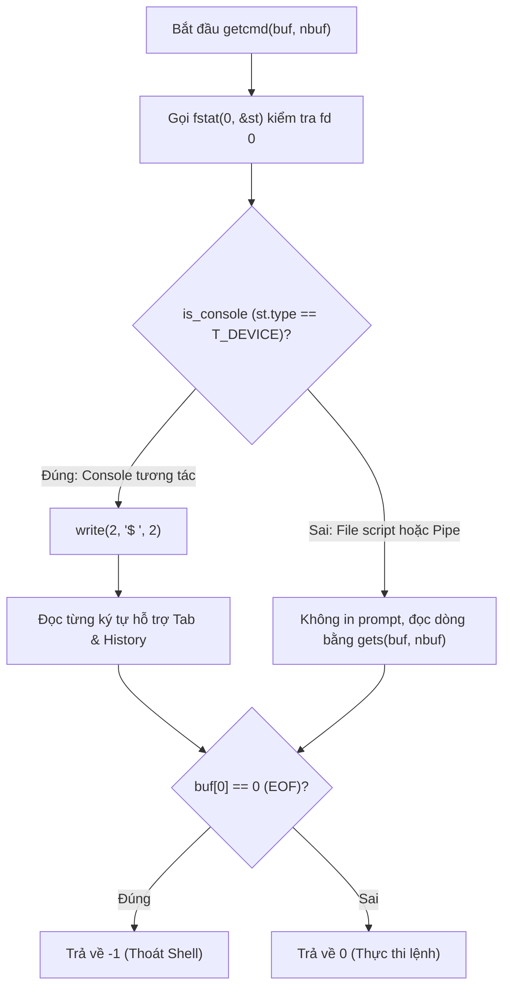
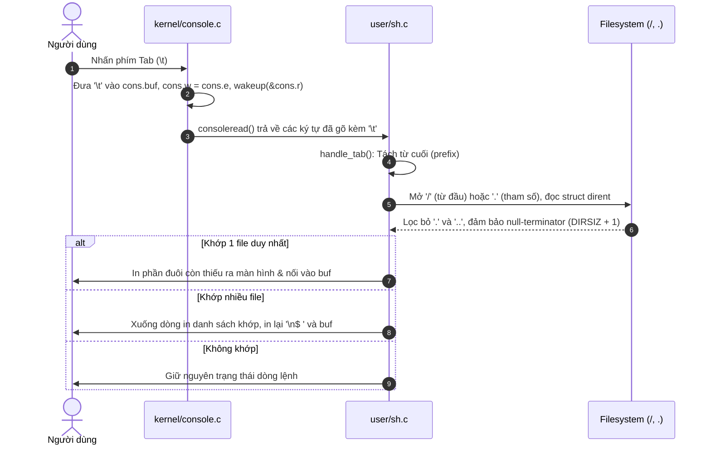
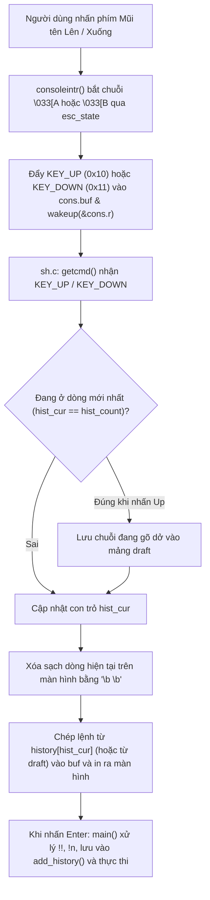

# BÁO CÁO ĐỒ ÁN 1: XV6 UTILITIES & SYSTEM CALLS
## PHẦN BÁO CÁO CỦA THÀNH VIÊN 3

---

## THÔNG TIN CHUNG

| Mục | Thông tin chi tiết |
| :--- | :--- |
| **Môn học** | Hệ điều hành |
| **Lớp học phần** | 24_21 |
| **Nhóm thực hiện** | 12 |
| **Hệ thống thử nghiệm** | Ubuntu 24.04.5 LTS / WSL2 – Kiến trúc RISC-V (qemu-system-riscv64) |
| **Cấu trúc nộp bài** | `MSSV1_MSSV2_MSSV3.zip` chứa `Report.pdf` và thư mục `Release/` |

### Thông tin thành viên phụ trách
- **STT:** 3
- **MSSV:** 24120389
- **Họ và tên:** Từ Quốc Nghĩa
- **Nhánh Git:** `util`
- **Nhiệm vụ chính phụ trách:** Cải tiến Shell (3a, 3b, 3c) & Tổng hợp Báo cáo
- **Tỉ lệ đóng góp:** 100% (phần 3)

---

## NỘI DUNG THỰC HIỆN: CẢI TIẾN SHELL (1.5 điểm)
*(Thuộc Phần 1: Lab Utilities - Nhánh `util`)*

---

### 3a. Không in "$" khi xử lý lệnh từ file
- **Người thực hiện:** 24120389 – Từ Quốc Nghĩa (Đóng góp: 100%)

#### Hướng giải quyết (Ý tưởng chính):
- Trong xv6 gốc, hàm `getcmd()` luôn ghi chuỗi `"$ "` ra stderr (fd 2) mà không kiểm tra bản chất luồng nhập chuẩn stdin (fd 0). Khi thực thi file script thông qua chuyển hướng (`sh < findtest.sh`) hoặc pipe, stdin không phải là thiết bị console nhưng Shell vẫn in dấu `"$ "` sau mỗi dòng lệnh gây sai lệch đầu ra.
- **Giải pháp:** Sử dụng system call `fstat(0, &st)` để kiểm tra kiểu thiết bị của stdin thông qua biến cờ `is_console = (fstat(0, &st) == 0 && st.type == T_DEVICE)`.
  - Nếu `is_console == 1` (tương tác bàn phím): In dấu nhắc `"$ "` và kích hoạt bộ đọc tương tác hỗ trợ Tab/Mũi tên.
  - Nếu `is_console == 0` (đọc từ file script hoặc pipe): Không in dấu nhắc `"$ "` và sử dụng hàm `gets(buf, nbuf)` nguyên bản của xv6 để đảm bảo đọc dòng lệnh từ script chuẩn xác tuyệt đối.

#### Thay đổi mấu chốt:
- **File chỉnh sửa:** `user/sh.c`
- Bổ sung header `#include "kernel/stat.h"` ngay sau `#include "kernel/types.h"`.
- Cập nhật kiểm tra thiết bị trong `getcmd()`:

```c
int getcmd(char *buf, int nbuf) {
  struct stat st;
  int is_console = (fstat(0, &st) == 0 && st.type == T_DEVICE);

  // Chỉ in dấu nhắc lệnh "$ " khi stdin là thiết bị console tương tác
  if (is_console) {
    write(2, "$ ", 2);
  }

  memset(buf, 0, nbuf);

  // Khi đọc lệnh từ file script (sh < script.sh) hoặc pipe,
  // sử dụng gets() thuần túy để giữ nguyên hành vi tiêu chuẩn của xv6
  if (!is_console) {
    gets(buf, nbuf);
    if (buf[0] == 0) // EOF
      return -1;
    return 0;
  }

  // ... (xử lý tương tác cho Tab và History khi is_console == 1)
}
```

#### Luồng hoạt động:



#### Kiểm thử & Hạn chế:
- **Kiểm thử:**
  - Chế độ tương tác: Khởi động `make qemu`, gõ các lệnh `ls`, `echo OK`, dấu nhắc `"$ "` hiển thị bình thường trước mỗi câu lệnh.
  - Chế độ file script: Chạy `sh < findtest.sh`, màn hình chỉ in kết quả thực thi của các lệnh trong script, không còn dấu `$` thừa.
- **Hạn chế:** Không có.

---

### 3b. Tab Completion
- **Người thực hiện:** 24120389 – Từ Quốc Nghĩa (Đóng góp: 100%)

#### Hướng giải quyết (Ý tưởng chính):
- Cơ chế mặc định của `kernel/console.c` chỉ trả dữ liệu về user-space khi gặp ký tự xuống dòng `\n` hoặc `C('D')`. Để hỗ trợ Tab Completion mà không làm xung đột cơ chế echo tự nhiên của Kernel (tránh lỗi nhân đôi ký tự khi chạy `./grade-lab-util`), giải pháp phối hợp đồng bộ giữa `kernel/console.c` và `user/sh.c`:
  - **Tầng Kernel (`kernel/console.c`):**
    - Khi bắt được phím Tab (`\t`), `consoleintr()` không echo khoảng trắng ra màn hình, ghi `'\t'` vào `cons.buf`, cập nhật `cons.w = cons.e` và gọi `wakeup(&cons.r)` để đánh thức `consoleread()` ngay lập tức.
    - Trong `consoleread()`, bổ sung điều kiện dừng vòng lặp khi gặp `c == '\t'`, `c == '\b'` hoặc `c == C('U')`.
    - Xử lý edge case xóa lùi (Backspace) sau khi bấm Tab: Khi `cons.w == cons.e` (do dữ liệu đã được đẩy lên Shell sau khi bấm Tab), nếu người dùng nhấn Backspace (`C('H')` hoặc `'\x7f'`), Kernel gửi tín hiệu `'\b'` lên cho Shell tự xóa ký tự đã điền trong `buf` và trên màn hình.
  - **Tầng User-space (`user/sh.c`):**
    - Khi `getcmd()` nhận ký tự `'\t'`, hàm `handle_tab(buf, &pos, nbuf)` được gọi để tìm khoảng trắng cuối cùng (`last_space`) và tách tiền tố `prefix`.
    - Phân vùng tìm kiếm: Nếu đang ở từ đầu tiên (`last_space == -1`), tìm kiếm trong thư mục gốc `"/"`; nếu ở các tham số tiếp theo (`last_space != -1`), tìm trong thư mục hiện tại `"."`.
    - Chặn tràn màn hình ở đầu dòng (Phương án B): Nếu ở đầu dòng lệnh chưa gõ ký tự nào (`last_space == -1 && prefix[0] == '\0'`) thì bỏ qua; nhưng nếu đã gõ lệnh kèm dấu cách (ví dụ `cat <TAB>`) thì cho phép liệt kê toàn bộ file trong thư mục hiện hành `"."`.
    - Bảo vệ an toàn bộ nhớ (`DIRSIZ = 14`): Sao chép `de.name` sang mảng đệm `char name[DIRSIZ + 1]` và gán `name[DIRSIZ] = '\0'`, đồng thời lọc bỏ `.` và `..` trước khi so khớp bằng `prefix_match()`.
    - Hiển thị kết quả:
      - Khớp 1 kết quả: Ghi phần đuôi còn thiếu (tail) ra màn hình (`write(2, tail, 1)`) và nối vào `buf`.
      - Khớp nhiều kết quả: Xuống dòng mới, in danh sách các tên khớp cách nhau bởi dấu cách, sau đó xuống dòng in lại `"$ "` cùng nội dung `buf` đang gõ dở.

#### Thay đổi mấu chốt:
- **Tầng Kernel (`kernel/console.c`):**

```c
case C('H'): // Backspace
case '\x7f': // Delete key
  if (cons.e != cons.w) {
    cons.e--;
    consputc(BACKSPACE);
  } else if (cons.e - cons.r < INPUT_BUF_SIZE) {
    // Khi bộ đệm kernel rỗng (cons.e == cons.w), gửi '\b' lên shell
    // để shell xóa lùi trên buf đã hoàn thành trước đó.
    cons.buf[cons.e++ % INPUT_BUF_SIZE] = '\b';
    cons.w = cons.e;
    wakeup(&cons.r);
  }
  break;

case '\t': // Kích hoạt Tab completion
  if (cons.e - cons.r < INPUT_BUF_SIZE) {
    cons.buf[cons.e++ % INPUT_BUF_SIZE] = '\t';
    cons.w = cons.e;
    wakeup(&cons.r);
  }
  break;
```

- **Tầng User-space (`user/sh.c`):**

```c
static void handle_tab(char *buf, int *pos, int nbuf) {
  buf[*pos] = '\0';
  int last_space = -1;
  for (int i = 0; i < *pos; i++) {
    if (buf[i] == ' ')
      last_space = i;
  }
  char *prefix = (last_space == -1) ? buf : &buf[last_space + 1];
  char *dir_path = (last_space == -1) ? "/" : ".";
  if (last_space == -1 && prefix[0] == '\0')
    return;
  int fd = open(dir_path, O_RDONLY);
  if (fd < 0)
    return;
  struct dirent de;
  char matches[64][DIRSIZ + 1];
  int match_count = 0;
  while (read(fd, &de, sizeof(de)) == sizeof(de)) {
    if (de.inum == 0)
      continue;
    char name[DIRSIZ + 1];
    memmove(name, de.name, DIRSIZ);
    name[DIRSIZ] = '\0';
    if (strcmp(name, ".") == 0 || strcmp(name, "..") == 0)
      continue;
    if (prefix_match(prefix, name) && match_count < 64) {
      strcpy(matches[match_count++], name);
    }
  }
  close(fd);
  if (match_count == 1) {
    int p_len = strlen(prefix);
    char *tail = &matches[0][p_len];
    while (*tail && *pos + 1 < nbuf) {
      write(2, tail, 1);
      buf[(*pos)++] = *tail++;
    }
    buf[*pos] = '\0';
  } else if (match_count > 1) {
    write(2, "\n", 1);
    for (int i = 0; i < match_count; i++) {
      write(2, matches[i], strlen(matches[i]));
      if (i + 1 < match_count)
        write(2, " ", 1);
    }
    write(2, "\n$ ", 3);
    write(2, buf, *pos);
  }
}
```

#### Luồng hoạt động:



#### Kiểm thử & Hạn chế:
- **Kiểm thử:**
  - Gõ `ec<TAB>` → tự động điền thành `echo`.
  - Gõ `cat REA<TAB>` → tự động điền thành `cat README`.
  - Gõ `gr<TAB>` → xuống dòng liệt kê `grep grind`, sau đó in lại `$ gr`.
  - Gõ `ec<TAB>` thành `echo` rồi nhấn Backspace → xóa lùi bình thường từng ký tự của chữ `echo`.
- **Hạn chế:**
  - Độ dài tên file tối đa tuân theo giới hạn `DIRSIZ = 14` của filesystem xv6.
  - Chỉ hỗ trợ tìm kiếm trên thư mục gốc `"/"` và thư mục hiện tại `"."`, chưa hỗ trợ phân giải đường dẫn con nhiều cấp (như `dir/sub/fi<TAB>`).

---

### 3c. Lịch sử lệnh & Duyệt bằng phím mũi tên
- **Người thực hiện:** 24120389 – Từ Quốc Nghĩa (Đóng góp: 100%)

#### Hướng giải quyết (Ý tưởng chính):
- **Bắt chuỗi phím Mũi tên tại tầng Kernel (`kernel/console.c`):**
  - Phím Mũi tên gửi chuỗi ANSI Escape 3 byte: Mũi tên lên là `\033[A`, Mũi tên xuống là `\033[B`.
  - Sử dụng máy trạng thái hữu hạn (FSM) với biến `esc_state` (0: Normal, 1: nhận `\x1b`, 2: nhận `'['`) trong `consoleintr()`.
  - Khi nhận `'A'` ở trạng thái 2, Kernel đẩy mã điều khiển `KEY_UP` (0x10) vào `cons.buf`; khi nhận `'B'`, đẩy mã `KEY_DOWN` (0x11) vào `cons.buf`, cập nhật `cons.w = cons.e` và đánh thức `consoleread()`.
  - Mọi nhánh thoát sớm trong FSM đều gọi `release(&cons.lock)` để ngăn chặn hoàn toàn lỗi Deadlock spinlock, đồng thời chặn bỏ các chuỗi CSI khác (như mũi tên Trái/Phải) để không in ký tự rác ra màn hình.
- **Đồng bộ hiển thị, Lưu nháp (draft) và Quản lý Lịch sử tại tầng Shell (`user/sh.c`):**
  - Duy trì mảng vòng `history[MAX_HIST][MAX_CMD_LEN]` (`MAX_HIST = 16`, `MAX_CMD_LEN = 100`) và bộ đếm `hist_count` tại `user/sh.c`.
  - **Lưu nháp dòng đang gõ dở (draft):** Khi người dùng đang gõ dở một câu lệnh ở dòng hiện tại (`hist_cur == hist_count`) rồi nhấn Mũi tên lên (`KEY_UP`), nội dung đang gõ được sao chép vào biến `draft` trước khi xóa dòng hiện tại bằng chuỗi `"\b \b"` và thay bằng lệnh lịch sử. Khi nhấn Mũi tên xuống (`KEY_DOWN`) quay về lại vị trí cuối (`hist_cur == hist_count`), nội dung từ `draft` được khôi phục nguyên vẹn lên màn hình.
  - **Lệnh built-in `history`, mở rộng `!!` và `!n`:** Trong `main()`, cắt bỏ `\n`, `\r` ở cuối chuỗi, kiểm tra và mở rộng `!!` (lệnh gần nhất) hoặc `!n` (lệnh thứ n tính từ 1) có kiểm tra biên an toàn (`hist_count == 0` hoặc n ngoài khoảng `[min_idx, max_idx]`), lưu lệnh hợp lệ vào `add_history(cmd)` và xử lý lệnh nội bộ `history`.

#### Thay đổi mấu chốt:
- **Tầng Kernel (`kernel/console.c`):**

```c
#define KEY_UP 0x10
#define KEY_DOWN 0x11
static int esc_state = 0; // 0: Normal, 1: ESC (0x1b), 2: '['

// Trong consoleintr(int c):
if (esc_state == 1) {
  if (c == '[') {
    esc_state = 2;
    release(&cons.lock);
    return;
  }
  esc_state = 0;
} else if (esc_state == 2) {
  esc_state = 0;
  if (c == 'A') { // Up arrow -> gửi tín hiệu KEY_UP
    if (cons.e - cons.r < INPUT_BUF_SIZE) {
      cons.buf[cons.e++ % INPUT_BUF_SIZE] = KEY_UP;
      cons.w = cons.e;
      wakeup(&cons.r);
    }
    release(&cons.lock);
    return;
  } else if (c == 'B') { // Down arrow -> gửi tín hiệu KEY_DOWN
    if (cons.e - cons.r < INPUT_BUF_SIZE) {
      cons.buf[cons.e++ % INPUT_BUF_SIZE] = KEY_DOWN;
      cons.w = cons.e;
      wakeup(&cons.r);
    }
    release(&cons.lock);
    return;
  } else {
    release(&cons.lock);
    return;
  }
}
if (c == '\x1b') {
  esc_state = 1;
  release(&cons.lock);
  return;
}
```

- **Tầng User-space (`user/sh.c`):**

```c
// 1. Duyệt phím Mũi tên Lên / Xuống trong getcmd():
if (c == KEY_UP) {
  int min_hist = (hist_count > MAX_HIST) ? (hist_count - MAX_HIST) : 0;
  if (hist_cur > min_hist) {
    if (hist_cur == hist_count) {
      buf[pos] = '\0';
      strcpy(draft, buf); // Lưu nháp dòng đang gõ dở
    }
    hist_cur--;
    while (pos > 0) {
      pos--;
      write(2, "\b \b", 3);
    }
    strcpy(buf, history[hist_cur % MAX_HIST]);
    pos = strlen(buf);
    write(2, buf, pos);
  }
  continue;
}
if (c == KEY_DOWN) {
  if (hist_cur < hist_count) {
    hist_cur++;
    while (pos > 0) {
      pos--;
      write(2, "\b \b", 3);
    }
    if (hist_cur == hist_count) {
      strcpy(buf, draft); // Khôi phục bản nháp
    } else {
      strcpy(buf, history[hist_cur % MAX_HIST]);
    }
    pos = strlen(buf);
    write(2, buf, pos);
  }
  continue;
}

// 2. Mở rộng !!, !n và thực thi lệnh history trong main():
if (cmd[0] == '!' && cmd[1] == '!' && cmd[2] == '\0') {
  if (hist_count == 0) {
    fprintf(2, "sh: no history available\n");
    continue;
  }
  strcpy(buf, history[(hist_count - 1) % MAX_HIST]);
  cmd = buf;
  printf("%s\n", cmd);
} else if (cmd[0] == '!' && cmd[1] >= '0' && cmd[1] <= '9') {
  int n = atoi(cmd + 1);
  int min_idx = (hist_count > MAX_HIST) ? (hist_count - MAX_HIST + 1) : 1;
  int max_idx = hist_count;
  if (hist_count == 0 || n < min_idx || n > max_idx) {
    fprintf(2, "sh: event not found: %d\n", n);
    continue;
  }
  strcpy(buf, history[(n - 1) % MAX_HIST]);
  cmd = buf;
  printf("%s\n", cmd);
}
add_history(cmd);
if (strcmp(cmd, "history") == 0) {
  int start = (hist_count > MAX_HIST) ? (hist_count - MAX_HIST) : 0;
  for (int i = start; i < hist_count; i++) {
    printf("%d %s\n", i + 1, history[i % MAX_HIST]);
  }
  continue;
}
```

#### Luồng hoạt động:



#### Kiểm thử & Hạn chế:
- **Kiểm thử:**
  - Vừa khởi động Shell, gõ ngay `!!` hoặc `!1` → Báo lỗi `sh: no history available` / `sh: event not found: 1`, không bị crash Shell.
  - Gõ `echo first`, `echo second`, sau đó gõ dở `cat R` rồi bấm Mũi tên lên → hiện `echo second`, bấm Mũi tên xuống → khôi phục lại đúng chữ `cat R`.
  - Gõ `history`, `!!`, `!1` → in và thực thi lại đúng lệnh tương ứng.
  - Chạy `./grade-lab-util` → toàn bộ script chấm tự động chạy ổn định, không xảy ra lỗi lặp ký tự.
- **Hạn chế:**
  - Lệnh `history` là lệnh nội bộ (built-in) được xử lý trực tiếp ở tiến trình cha trước khi `fork()`, do đó chưa hỗ trợ kết nối trực tiếp qua pipe (như `history | grep echo`).
  - Hỗ trợ thay thế và chỉnh sửa từ cuối dòng lệnh, chưa hỗ trợ di chuyển con trỏ sang trái/phải (`\033[D`, `\033[C`) để chèn ký tự vào giữa dòng.

---

## BẢNG TỰ CHẤM ĐIỂM (PHẦN THÀNH VIÊN 3)

| STT | Bài tập | Điểm tối đa | Điểm tự chấm | Thành viên phụ trách | Trạng thái hoàn thành |
| :---: | :--- | :---: | :---: | :--- | :--- |
| **3** | **Cải tiến shell (3a, 3b, 3c)** | **1.5** | **1.5** | **Từ Quốc Nghĩa** | **Đã hoàn thành 100%** |

---

## QUY TRÌNH BUILD & KIỂM THỬ (NHÁNH UTIL)

Quy trình biên dịch và kiểm thử liên quan đến các tính năng cải tiến Shell:

```bash
# 1. Chuyển sang nhánh làm việc util
git checkout util

# 2. Biên dịch và chạy bộ kiểm thử tự động
make clean
./grade-lab-util

# 3. Kiểm thử thủ công các tính năng cải tiến Shell (Bài 3a, 3b, 3c)
make qemu
# Trong QEMU:
# - Test 3a: sh < findtest.sh
# - Test 3b: ec<TAB>, cat REA<TAB>, gr<TAB>, cat <TAB>
# - Test 3c: history, !!, !1, phím Mũi tên Lên/Xuống (kèm lưu nháp draft)
# Thoát QEMU: Nhấn Ctrl+A rồi nhấn X

# 4. Tạo file patch cho nhánh util
mkdir -p Release
git diff origin/util > Release/util.patch
```
